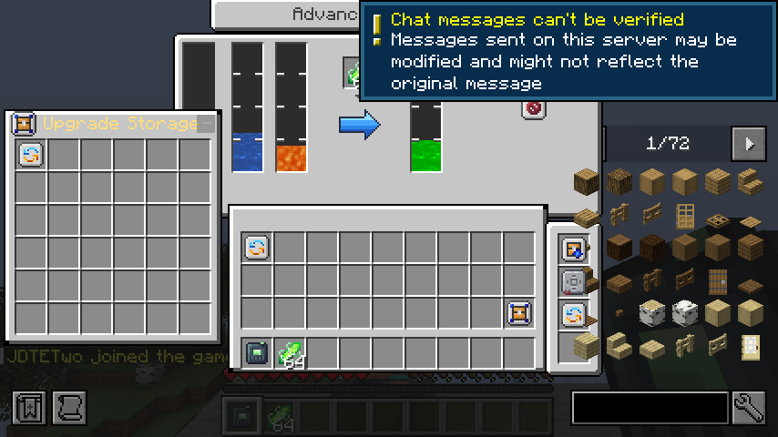
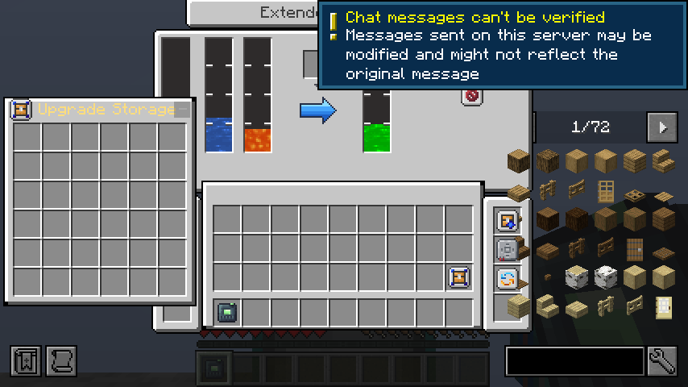

# AE acceleration and production runtime follow-up

Starting commit: `5498124`. Reference: JDTE 0.6.5.2 `ccf46472abaf3856fa9eebe0f5ebd25d8f28e859`. Version remains `0.5.8-forge-1.20.1`.

## Implementation and server suite

AE Acceleration is installed in all three existing Time Accelerators, using their current fluid-cost and bounded scheduler settings. Native AE service discovery requires each contributor's own card; pending AE work loses removed-card contributions. Optional whole-grid backends use the source registration/frame contract, with active/inactive routing and no duplicate native fallback. No actual JDTE-AE backend mod is claimed as tested.

At the initial implementation checkpoint the full build passed **95 JUnit tests and 112 required GameTests**, preserving all earlier 81/108. New tests include ten original backend-registration tests, four frame-order/exception-cleanup unit tests and four real AE2 integration GameTests. The latter use a powered real Inscriber: AE's native one-tick request advances two processing units, so twelve requests advance 24 rather than twelve. Initial fixture expectations were corrected accordingly. The first attempt to unit-test the registry-backed scheduler directly failed during Minecraft tag bootstrap; the exact frame logic was isolated into a common helper and all four tests now run successfully without world bootstrap. No exception assertions were removed.

`suite.txt` retains selected final output. Production and separately packaged probe reobfuscation passed. Graphical harnesses compile and stay outside the production JAR.

## Active real crafting job, save and fresh JVM

`active-job-restart-first.txt` identifies the first production JAR and actual two-JVM results. A real Pattern Provider feeds the real Extended Fluid Mixer while a real AE CPU waits for 500 mB Time Fluid. Before the first batch completes, redstone pauses the mixer at partial progress while the actual CPU remains busy. The server saves, verifies the saved live job, then shuts down normally.

A second JVM compares exact mixer fields before grid boot, waits for the actual nonempty busy CPU to return, verifies the restored read binding and resumes native machine work. Advanced AE Output returns exactly 500 mB to ME, catalysts/water are consumed exactly once, total FE cost is exactly 10,000, and the completed job pauses the machine again. Both JVMs exit 0. These are real persisted CPU jobs, rather than a recreated plan or fake busy snapshot.

## Earlier compiled-fixture checkpoint

Two independent mixer clients and an actual Mekanism Extras runtime probe are compiled but have not run yet. The publicly available Forge 1.20.1 Extras 1.5.0 recipe set contains fluorinated naquadah uranium fuel; no silicon fuel recipe was found in that JAR's datapack resources. Final runtime evidence will distinguish actual tested recipes from unavailable version-specific content.

## Verified Mekanism Extras liquid fuel

Mekanism Extras **1.5.0 for Forge 1.20.1** was downloaded through its public Modrinth release metadata; the published SHA-512 was verified. `mekanism-artifact.json` records the exact release URL/hashes, dependency versions and tested JDTE JAR hash. No third-party JAR is committed or bundled.

The actual installed recipe `mekanism_extras:chemical_infusing/fluorinated_naquadah_uranium_fuel` mixes liquid `mekanism:uranium_hexafluoride` with `mekanism_extras:naquadah_hexafluoride` into real `mekanism_extras:fluorinated_naquadah_uranium_fuel` at 1:1:2. The packaged Chinese localization calls the output **液态含氟硅岩铀燃料**. Naquadah is 硅岩 in this addon; an English search for elemental `silicon` alone does not identify this chain. The earlier metadata-only observation above must not be read as absence of the naquadah fuel recipe.

`mekanism-fuel.txt` records actual reobfuscated production-JAR execution with Mekanism 10.4.16.80 and Extras 1.5.0 installed. Both mixer tiers run 100 native recipe work calls with deliberately reversed inputs. Ordinary Mixing completes eight batches; Ultimate Mixing Parallel completes 25. Fluid quantities and 5,000 FE per batch are exact. The output is the real registered liquid rather than empty/air, and the addon's actual downstream RotaryRecipe accepts it and produces the correct nonempty fuel gas. No complete reactor cycle or operating downstream rotary machine is claimed; downstream recipe acceptance is the checked boundary.

This fixture also runs with AE2/Curios/JEI/Jade absent. Extras itself logs missing optional-generator scan data and unrelated loot/tag entries; selected warnings are retained in `mekanism-third-party-warnings.txt`. They were not suppressed or patched, and successful mixer fuel verification does not claim every Extras machine or optional combination is valid.

Reproduce with an existing marked disposable Forge installation, the verified Extras JAR and matching Mekanism JAR:

```bash
export JDTE_LIFECYCLE_SERVER=/path/to/disposable/forge-server
export JDTE_MEKE_JAR=/path/to/mekanism_extras-1.20.1-1.5.0.jar
export JDTE_MEKANISM_JAR=/path/to/Mekanism-1.20.1-10.4.16.80.jar
bash scripts/run_mekanism_fuel_probe.sh
```

## Natural ticker coverage and multiplayer fixture history

The later complete suite passes **95 JUnit / 113 required GameTests**. A fifth acceleration test installs the actual card, enables the real Basic accelerator block ticker and lets the global scheduler complete the native Inscriber recipe without directly calling the frame or service bridge. The reusable press and exactly one silicon print are verified, as is the source Time Fluid ledger. Source costs can remain fractional before a whole mB drains; the test checks either the actual drain or saved positive fractional debt, correcting an early integer-only fixture assumption. Config-disable invalidation is now checked alongside card removal.

`mixer-first-attempt.txt` and `mixer-second-attempt.txt` preserve failed fixture runs. The first passed gameplay phases but waited for a tossed logout stack to reach stationary players. The second detected a contaminated **pre-interaction** baseline (192 catalysts) when the prior failed world's 64-item entity loaded after ServerStarted. The one-time fixture cleanup now waits until both clients have their chunks, before the 128-catalyst/5-card baseline and before any tested action. No drops are discarded during gameplay checks. Reconnect uses the established natural-pickup setup from the earlier mineral fixture. These corrections do not change production item handling or assume a passing multiplayer result.

## Submitted accelerator lifecycle guard

Final review found that a submitted accelerator can be dismantled by another machine before the END-phase scheduler queries upgrades. Active contributors are now filtered for removal, matching level, loaded position and current world block-entity identity before capability access or backlog retention. A regression queues real Inscriber work, dismantles its contributor, checks safe removal of paid backlog, then clears the old removed flag and verifies that the detached reference remains inactive.

The complete build passes **95 JUnit / 114 required GameTests**, with all original 81/108 retained. The earlier 113-test production runtime results passed; the final same-JAR runtime rerun follows this guard checkpoint. This is a defensive lifecycle correction found in code review; no real public-server crash is claimed.

## Final actual mixer multiplayer result

Final source checkpoint: `9970bd6`. Two independent graphical Forge JVMs (`JDTEOne`, `JDTETwo`) connected simultaneously to the separate production Forge 47.4.10 server. The same two original client processes later reconnected to a fresh server JVM. All four processes exited 0. Final output is retained in `mixer-multiplayer.txt`; selected login/save lines are retained separately.

- Both players raced the same 64-catalyst slot, observed the authoritative winner, deposited legally sized cursors, and Shift-returned the stack. They raced ordinary Mixing insertion, pasted the same advanced-copier configuration and repeated shared catalyst operations on the Extended tier while concurrently inserting cards through their actual advanced-bag machine panels.
- The server checks every phase against **128 catalysts and five Mixing cards**, including player inventories, both machine inventories, preset-source cards, bags, cursors and world drops. Both clients also verify three high-bit tank amounts (120,000/80,000/100,000 mB), 400,000 mB capacity and 123,456 FE. All tank quantities, FE, 73 ticks of progress and installed upgrades remain consistent.
- One player disconnects with a real nonempty catalyst cursor. Vanilla drops it; the fixture checks the combined inventory/drop ledger and moves the reconnected player into natural pickup range. After both clients disconnect, the server observes the actual mixer chunks becoming unavailable, saves and exits normally.
- The fresh server compares exact persisted machine state and player inventories. The same two client JVMs reconnect and open Advanced/Extended menus, verifying four/eight slots, all synchronized quantities and empty cursors. Inspected screenshots are below.

## Final production artifact checks

`summary.json` records the final JAR/probe checksums, exact suites and actual process exits. The **same production JAR** was used in the final multiplayer, active-job restart and Extras fuel reruns. The complete suite passes **95 JUnit / 114 required GameTests**, preserving all original 81/108. Full build and both reobfuscation tasks passed, and smoke fixtures remain outside the production JAR.

The final active-job rerun again restored the actual saved busy CPU, resumed partial mixer progress, produced exactly 500 mB through Advanced AE Output at 10,000 FE and paused afterward. That dedicated runtime has AE2 installed and Curios/JEI/Jade absent. The final Extras runtime, with AE2/Curios/JEI/Jade absent, again passed actual fuel production and native downstream recipe acceptance. No fresh job was submitted after loading to simulate persistence.

## Reproduce final multiplayer and active-job checks

Use the existing marked disposable Forge installation described in the earlier network/lifecycle evidence. Mixer multiplayer requires loopback port 25579 and a captured development-client launch; all source sets must be compiled before starting either graphical client. Avoid rebuilding shared class directories during client execution.

```bash
bash gradlew test build runGameTestServer compileClientSmokeJava --no-daemon --max-workers=2
export JDTE_LIFECYCLE_SERVER=/path/to/disposable/forge-server
JDTE_REMOTE_SCENARIO=mixer bash scripts/run_mineral_multiplayer_smoke.sh
bash scripts/run_ae_crafting_restart_probe.sh
```

The multiplayer runner prepares a marked `/tmp/jdte-mixer-remote-control` directory, retains both client/server logs and checks every success marker/process exit. It builds/captures the remote launch unless `JDTE_SMOKE_PREBUILT=1` is explicitly requested. Use a separate fixture or run the active-job probe after multiplayer finishes; do not share a live server/world between probe processes. Probe scripts replace only their marked fixture areas and must never target a real user world.

## Remaining scope

The actual separately installed JDTE-AE whole-grid backend was unavailable: only the source API/frame routing, simulated backend contract and real built-in AE device path are verified. Long-running public-server stress, every other Extras release/mod combination and an operating complete rotary-machine/reactor cycle remain unverified. The fuel boundary checked here includes actual machine production and the native downstream recipe, not the complete reactor. No other large machine subsystem was added in this follow-up. Version remains 0.5.8; no main merge or release occurred.




