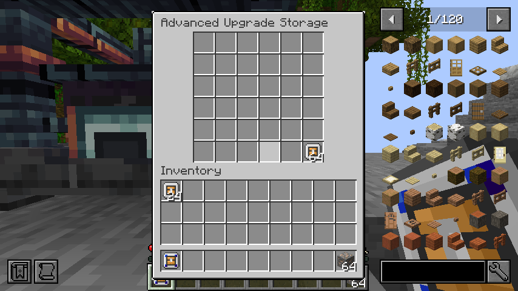
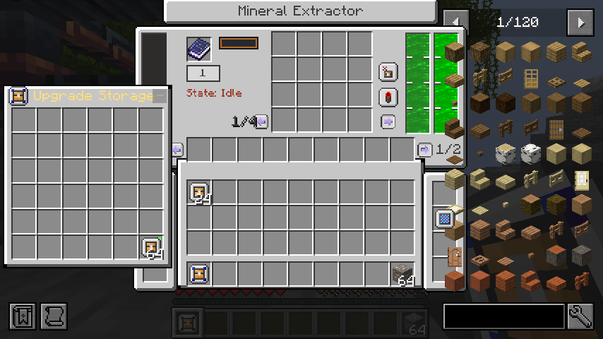
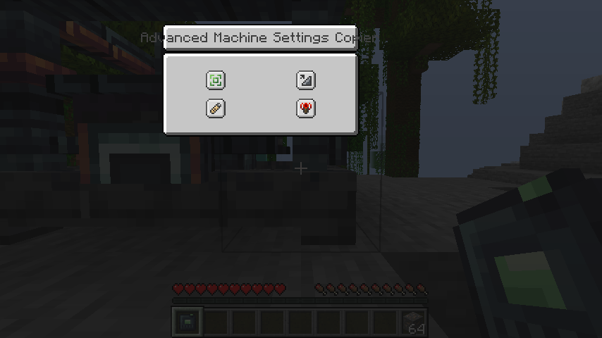

# Forge 1.20.1 lifecycle and inventory integration evidence

Reference: JDTE 0.6.5.2 `ccf46472abaf3856fa9eebe0f5ebd25d8f28e859`. Starting checkpoint: `2bdf14e`. Mod version is still `0.5.8-forge-1.20.1`.

## Results

| Check | Actual outcome |
| --- | --- |
| Java 17 / Gradle 8.6 `test build serverSmokeJar runGameTestServer` | Passed, including production reobfuscation |
| JUnit | 58 passed; original 24 mineral core tests retained |
| Forge GameTests | 57 required tests passed |
| Production Forge 47.4.10 / JDT Forge 1.1.4, seed JVM | Passed real chunk unload/reload, endpoint checks, snapshots and normal saved shutdown; exit 0 |
| Fresh production server JVM | Passed exact disk-state restoration and resumed production with bounded output/resource costs; normal shutdown, exit 0 |
| Real graphical Forge client | Passed; Xorg dummy display and llvmpipe, integrated server, exit 0 |
| Production JAR isolation | Neither client nor server smoke classes are included |
| Documentation consistency / Git whitespace | Passed |

`summary.json` records the exact production JAR checksum and test counts. The adjacent `.txt` files retain selected verbatim final log lines. Minecraft log timestamps in these files are UTC. This folder intentionally excludes full worlds, JARs, dependency caches and long third-party logs.

## Actual coverage

- Ordinary mineral destruction conserves all 409.6 million output items in 64 bulk item entities, with no duplicate inventory or upgrade handler retained in the block item. FE remains in the block item's machine data. Bulk entities preserve integer counts across NBT and partial/full-player-inventory pickup.
- Full-player-inventory wrench pickup drops one intact large machine. Wrench reconstruction preserves FE, both fluids, the fourth survey, oversized output, upgrades, multiplier and both pending work queues.
- Complete Factory Packer capture/place and horizontal rotation preserve all 64 full output slots, four surveys, FE, both fluids, upgrades and pending work. Partial-structure capture is rejected before removing blocks or producing a package. Tests use the real asynchronous packer pipeline and a fake owner registered for permission lookup; no remote-player login is claimed by those tests.
- The standalone probe releases nearby forced tickets and observes the controller chunk becoming unavailable. A retained relay cannot write to an unloaded controller. After reload, the current part routes to the current controller; a reused live chunk object may reconnect, while a genuinely detached endpoint stays invalid. A separate regression checks that clearing a detached object's removed flag cannot bypass the current-block-entity identity check.
- Both production machines restore full inventories, FE, both fluids, all surveys, upgrades, multiplier and queued work. The second JVM opens space for seven fortune cycles, then verifies exactly fourteen output items, 35,000 FE and 175 mB XP Fluid consumed.
- Advanced storage covers 36 slots, compressed unstackable upgrades, persistence/capability access, legal Shift transfers, bound-item protection, deduplicated case discovery, Curios sources, all six server actions and stale-window/index rejection.
- Copier coverage includes native basic filter/redstone copying, exact-type/schema validation, advanced custom mineral settings, reuse of matching installed cards, missing-card rejection without mutation, empty-preset refunds, full-inventory drops, basic/advanced case costs, Curios withdrawals and compressed-card rollback. Inventory, FE and progress are not cloned by configuration pastes.
- The real client checks normal/large/survey menus, fluid/page/count packets, JEI, Jade through parts, both case menus, advanced side-panel insertion and count conservation, native copier option packets, and integer synchronization of a 6.4-million-item bulk drop. Screenshots below were inspected.

## Reproduce

Reuse Java 17, Gradle 8.6 and the already configured dependency caches. Supply the existing cloud Java proxy flags when needed.

```bash
bash gradlew test build serverSmokeJar runGameTestServer --no-daemon --max-workers=2
bash scripts/run_mineral_client_smoke.sh
python scripts/validate_docs.py
```

For the production probe, prepare a separate existing Forge 47.4.10 server with the runtime dependency mods. Use `server-ip=127.0.0.1`, `level-name=lifecycle-world`, an accepted EULA and a free loopback port. Place `.jdte-lifecycle-fixture` **only in that disposable test server**. Seeding replaces the probe's own fixture coordinates. The script never installs Java or Forge and refuses an unmarked server.

```bash
export JDTE_LIFECYCLE_SERVER=/path/to/disposable/forge-server
bash scripts/run_mineral_lifecycle_probe.sh
```

The script builds/copies the production and separate probe JARs, starts two different JVMs, checks their exit codes and fresh success markers, and preserves `lifecycle-seed.log` / `lifecycle-verify.log` in the fixture directory.

## Screenshots







## Unverified and remaining

Two independent remote clients connected to a dedicated server have **not** been run. Existing two-menu server tests and one integrated graphical client are not equivalent to that scenario. A full optional-mod absence matrix, long-running automation/throughput tests and all remaining unported registrations are also unfinished. See [the progress document](../../forge-1.20.1-port.md).

Earlier failed attempts were corrected and rerun: test ticket coverage, endpoint object reuse expectations, networkless fake-login setup, unpaused production fixtures, mock-player drop position and one concurrent development compilation. Final results above refer to the final passing runs. Third-party missing optional recipe/tag references and update/authentication network failures remain visible in the full cloud runtime logs; no JDTE recipe parsing or Mixin failure occurred in the final production runs.
