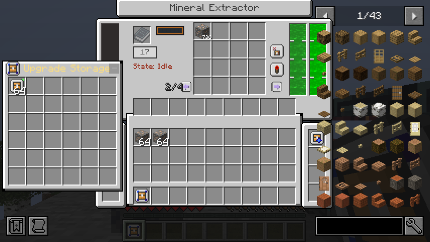
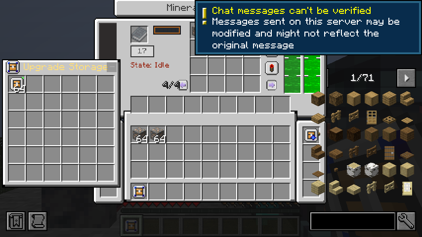

# Independent remote-client and optional-dependency evidence

Reference: JDTE 0.6.5.2 `ccf46472abaf3856fa9eebe0f5ebd25d8f28e859`. Starting commit: `8563466`. Mod version remains `0.5.8-forge-1.20.1`.

## First-phase runtime result

Two separate graphical Forge client JVMs (`JDTEOne` and `JDTETwo`) connected simultaneously to a separate production Forge 47.4.10 server on loopback. Authentication was disabled only in this marked disposable fixture. The server used JDT Forge 1.1.4, GuideME, AE2, Curios, JEI, Jade and ModernFix. Both clients and both server processes exited normally with code 0.

- Both clients clicked the same output inventory through actual vanilla menu packets. Independent output pages stayed independent and conserved 256 extracted ore items.
- Both clients concurrently used advanced bag machine-panel actions and advanced copier pastes. Stale window IDs were rejected. Capacity cards across players, bags, machines and drops remained exactly 128, including refunds.
- Each player opened their own bag and performed real pickup/deposit/Shift operations. Bound bags and inventories persisted.
- One client disconnected with a nonempty cursor. Vanilla dropped the cursor stack; the probe counted player inventories plus world drops, then verified natural pickup after reconnect. It does not assume logout puts the cursor directly into inventory.
- Both players disconnected before an observed real controller chunk unload. The server saved and stopped normally. A new server JVM restored the exact player inventories and machine state; both original client JVMs reconnected and opened synchronized menus again.
- Missing-client-block-entity upgrade queries are now safe while a chunk is arriving. The harness still waits for the actual client chunk before opening the server menu.

The server snapshot comparison ignores only JDT's empty ghost-filter metadata expansion from `Size:9` to `Size:27` after reopening a menu. Actual filter items, inventories, energy, fluids, upgrades, survey, multiplier and pending work are compared. No item-bearing NBT is excluded.

## Optional dependencies

An actual reobfuscated production server with only Forge, JDT, JDTE and GuideME passed both lifecycle probe phases, including unload and a fresh JVM restart, with AE2, Curios, JEI and Jade all absent. An independently launched graphical client with the same four integrations absent reached the title screen and verified JDTE registration and the tank fluid capability.

This found a real startup defect: the large fluid tank directly implemented Curios' optional interface. The common item now exposes only its native Forge capability, and Curios behavior is registered through the guarded Curios bridge. The GameTest suite also checks that the Curios-present behavior remains available.

The runtime checksum in `summary.json` identifies the first-phase JAR, before the crafting/conversion/AE ports in this session. Final-JAR reruns passed after the new upgrade ports; they are recorded separately in the [upgrade checkpoint](../forge-1.20.1-upgrades/README.md). This is not a full combinatorial absence matrix or a long-running public-server stress test.

## Reproduction and retained files

Use the existing Java 17 installation and Gradle cache. `scripts/run_mineral_multiplayer_smoke.sh` builds/captures the development-client launch and runs `scripts/mineral_multiplayer_smoke.py`. Set `JDTE_LIFECYCLE_SERVER` to an explicitly marked disposable production Forge installation, configured for loopback port 25579 and `lifecycle-world`. The script refuses an unmarked server or control directory. It launches its own Xorg dummy display if no display exists; no tools are installed.

`scripts/run_optional_client_smoke.sh` reuses the captured client command, filters both runtime classpath lists using actual mod metadata, and requires a successful client exit and marker. Compile all source sets before launching graphical checks; do not rebuild shared exploded classes during a client run.

`summary.json`, success markers and selected server logs retain the first-phase evidence. Both screenshots were inspected. Log timestamps preserve their original runtime timezone; final-session logs use the host timezone recorded in their summary.

