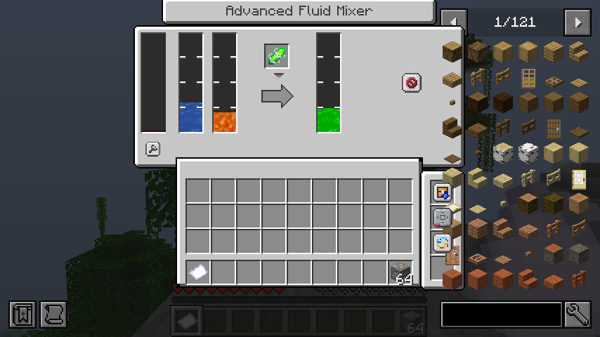
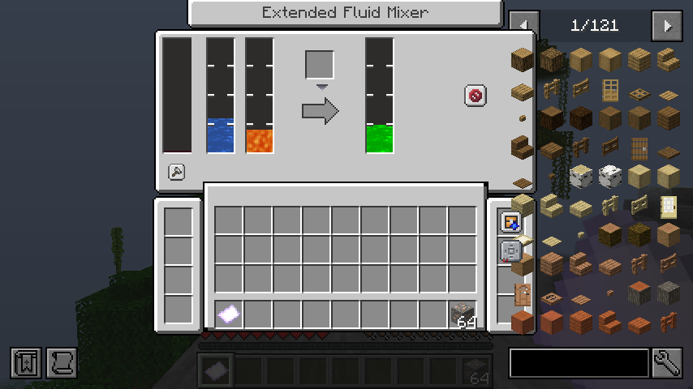
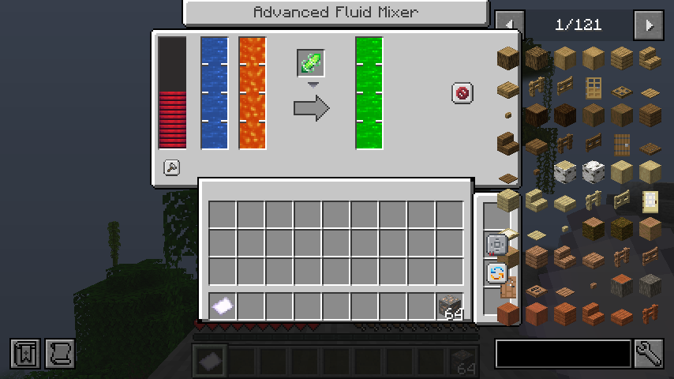
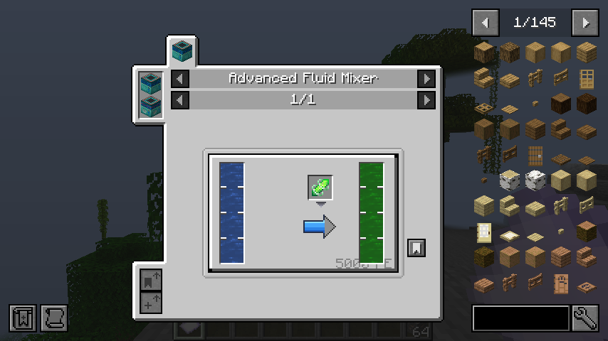

# Production-chain follow-up validation

Reference: JDTE 0.6.5.2 `ccf46472abaf3856fa9eebe0f5ebd25d8f28e859`. Starting commit: `a36c6c5`. Version remains `0.5.8-forge-1.20.1`.

## Real AE crafting jobs

The full configured development runtime passed 77 JUnit tests and 87 required Forge GameTests. `ae-jobs.txt` contains selected actual output, including executable AE plans and the final suite result. Existing tests were retained.

New tests use a real powered AE network, crafting storage, a Pattern Provider, a processing pattern, asynchronous plan calculation, CPU submission, an installed read/output pair on a working Mineral Extractor and linked fluid extraction equipment. Both normal completion and cancellation pause the machine again after the source cache expires. Tests deliberately wait for actual completion rather than treating a busy flag as success.

The source read upgrade is a network-wide activity gate; it does not match the mineral producer to a processing recipe or cap its output to the job request. The fixture's cobblestone trigger enters a chest and ore is independently produced by the real mineral machine. Extra ore remains in ME while the CPU/provider schedules the outstanding work.

The check runs in Forge's dedicated GameTest server. It is not a new independent-client GUI test, an active-job persistence test or proof of all supported machine families. Those scenarios remain unverified in this checkpoint.

## Seed Conversion

The next full suite passed 77 JUnit and 93 required GameTests. `seed-conversion.txt` retains the result. The source upgrade, resources and both greenhouse harvest paths are implemented. MA-specific tests invoke the actual harvest boundary with a deterministic crop generator and real machine inventories; they do not claim random MA loot sampling or independent-client GUI validation.

## Fluid Mixer server checkpoint

`mixer-server.txt` records the successful 81-unit/104-GameTest suite, including source parallel limits and eleven actual machine/menu/lifecycle tests. Both source mixer tiers, ordinary/ultimate parallel upgrades, machine registrations/resources and JEI integration are implemented. At this checkpoint mixer-specific graphical checks and real AE fluid processing jobs remain pending. The configured runtime does not contain Mekanism Extras, so its specific liquid-fuel chain is unverified.

## Real AE fluid processing jobs

`mixer-ae-jobs.txt` records the 81-unit/106-GameTest checkpoint. Both source mixer tiers complete an actual CPU processing job: a real Pattern Provider injects a consumed catalyst and 1,000 mB water, the native machine runs its 100-tick recipe, and the ordinary/advanced AE output variants return exactly 250 mB real Time Fluid. Both machines pay 5,000 FE and pause after the job ends. The Mineral Extractor completion/cancellation and busy-grid extraction tests are retained.

## Runtime corrections and final server suite

`final-suite.txt` records **81 JUnit and 108 required GameTests**, including the added real mixer tier-conversion regression. The source Extended Upgrade interaction now migrates tagged four-slot cards to the active eight-slot capability and clears the inactive copy, preserving tanks, energy, catalyst and work. The graphical catalyst slot coordinates now account for Forge JDT's widened top-panel origin. The final graphical retest passed with the final production code; see the final runtime table below.

`mixer-production.txt` records two actual reobfuscated production Forge server JVMs with **AE2, Curios, JEI, Jade, Mekanism and Applied Flux absent**. The seed JVM observes both mixer chunks genuinely unloaded, rejects a retained fluid endpoint while unloaded, then compares exact restored tank/FE/catalyst/upgrade/progress snapshots and saves normally. The second JVM restores those snapshots from disk and naturally completes saved 73/100-tick work exactly once, consuming 1,000 mB water, one catalyst and 5,000 FE for 250 mB Time Fluid. Both processes exit 0.

The first restart fixture failed because it expected completion at startup tick 35. Its recorded corrected-run observation shows progress 98, unchanged inputs and unchanged FE: only 25 machine ticks had elapsed after startup. The bounded probe now waits for actual completion rather than assuming forced chunks begin ticking immediately. Disk-state restoration had already passed; production work semantics were not changed to satisfy the fixture.

The optional-absence graphical client also reaches the title screen and verifies registrations/tank capabilities with AE2, Curios, JEI and Jade absent. This check does not open every mixer GUI without those mods. The production JAR contains neither graphical nor server-smoke probe classes.

## Reproduce

Reuse the configured Java 17/Gradle 8.6 environment and dependency caches, adding the existing environment proxy flags when needed:

```bash
bash gradlew test build runGameTestServer compileClientSmokeJava --no-daemon --max-workers=2
bash scripts/run_mineral_client_smoke.sh
bash scripts/run_optional_client_smoke.sh
python scripts/validate_docs.py
```

The optional client script reuses `/tmp/jdte-remote-launch.json`, captured by the earlier independent-client harness. See `../forge-1.20.1-network/README.md` for launch preparation. For production mixer lifecycle validation, reuse the marked disposable Forge installation described in `../forge-1.20.1-lifecycle/README.md`:

```bash
export JDTE_LIFECYCLE_SERVER=/path/to/disposable/forge-server
bash scripts/run_fluid_mixer_lifecycle_probe.sh
```

The fixture replaces its own mixer positions around `(1007,90,1000)` and `(1009,90,1000)`; it must never target a real user world. The script requires the marker, dedicated world name and loopback binding, checks fresh markers and both process exits, and retains `mixer-seed.log` / `mixer-verify.log`. No installation is required.

## Remaining scope

- New mixer-specific interactions by two independent remote clients were not rerun in this checkpoint. Earlier two-client mineral/storage/copier results retain their original scope.
- Server restart while a real AE crafting job remains active, every other machine family under real jobs, and prolonged public-server stress are unverified.
- Mekanism's optional adapter is implemented for Forge 1.20's gas infuser API and rejects unknown fluid equivalents. Mekanism Extras is absent here; its specific liquid uranium/silicon fuel recipe is unverified.
- Seed tests exercise deterministic actual harvest boundaries and recorded essence conversion; exhaustive crop-pack loot sampling and a new seed-specific graphical check were not run.
- Unchecked registrations in `../../forge-1.20.1-port.md` remain unported, including AE Acceleration, biological extractors, energy transmitters, entity accelerators, lightning machinery, generator families and portable canister/wand tools.

## Final runtime evidence

Code checkpoint: `b2466c5`. `summary.json` records the final JAR/probe SHA-256 values, exact unit-test suites/counts and actual runtime scope. Source version remains 0.5.8; no release or main-branch merge was performed.

| Check | Actual result |
| --- | --- |
| Java 17 / Gradle 8.6 full build, production and probe reobfuscation | Passed |
| Unit tests | 81 passed, zero failures; all earlier suites retained |
| Dedicated Forge GameTests | All 108 required tests passed; earlier 85 retained |
| Actual graphical Forge client with configured optional mods | Passed; exit 0 |
| Both mixer menus, high-bit values, capacity clamp, Shift mixing insertion | Passed |
| Displayed catalyst slot, complete mouse press/release and vanilla inventory packets | Passed; authoritative catalyst remains in slot and cursor is empty |
| Small scaled window/resize and title placement | Passed; final origin 125,44 and slot 64,-12 |
| Real JEI recipe/category | Passed; actual synced recipe, stable ID and nonempty Time Fluid output |
| Minimal production server chunk unload/reload and fresh-JVM work resumption | Passed in two actual JVMs, exits 0/0 |
| Graphical title/registration/tank check without AE2, Curios, JEI or Jade | Passed; exit 0 |
| Production JAR isolation, documentation consistency and Git whitespace | Passed |

`mixer-client.txt`, `optional-client.txt`, `mixer-production.txt` and `final-suite.txt` retain selected actual output. The graphical fixture also repeats the existing mineral/survey, bag/copier, integer bulk-drop and crafting-pattern checks; they all passed. The latest final run lasted 3m 5s. Two early new click assertions failed (the initial version omitted mouse release); the later diagnostic run and final split-operation run passed. The final fixture waits for cursor synchronization before sending a complete displayed-slot click. These earlier attempts are not counted as passing runs. Third-party optional-item guide warnings and unavailable authentication/update endpoints remain visible in full fixture logs; they did not prevent final successful checks.

Screenshots below were inspected: catalyst background/item/click target align, titles stay visible, and fluid rendering stays inside all three bars after capacity removal.









## Continue

Resume the pushed `codex/forge-1.20.1-mineral-machines` branch, preserving subsequent commits rather than resetting to an old baseline. The linked progress file is authoritative for still-unported registrations. AE Acceleration is a useful next dependency checkpoint; independently, add two-player mixer interaction and active-AE-job restart probes. Keep 0.5.8 until the complete port and validation finish.
