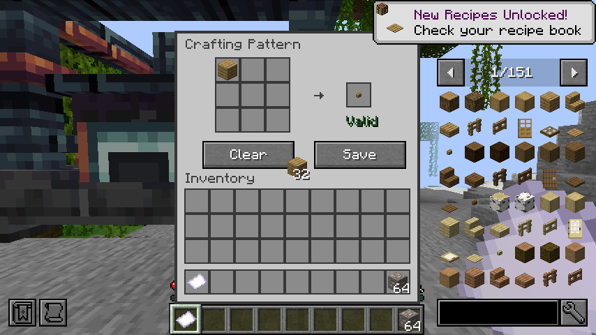

# Crafting, conversion and AE upgrade validation

Pinned source: JDTE 0.6.5.2 `ccf46472abaf3856fa9eebe0f5ebd25d8f28e859`. Starting branch commit: `8563466`. Version: `0.5.8-forge-1.20.1`.

The final development suite passed **77 JUnit tests** and **85 required Forge GameTests**, including all earlier 58/57 tests. `test build runGameTestServer compileClientSmokeJava` completed successfully under the existing Java 17 / Gradle 8.6 setup. Both the production JAR and separate lifecycle probe JAR were reobfuscated.

See the [port checkpoint](../../forge-1.20.1-port.md#multiplayer-conversion-and-ae-upgrades-checkpoint-2026-10-27) for implementation details and test coverage. Final runtime reruns passed with the same code and the JAR identified in `summary.json`. All test JVMs exited normally with code 0. The implementation is saved in pushed commit `1588372`; the evidence is saved by the subsequent documentation commit.

## Final runtime outcomes

| Check | Actual result |
| --- | --- |
| Full graphical client with integrated server | Passed all earlier mineral/storage/copier/JEI/Jade/bulk-entity checks plus real crafting-pattern ghost clicks, result synchronization and persisted save packets |
| Two independent remote graphical clients | Passed simultaneous shared/independent output menus, concurrent upgrade storage/copier actions, cursor logout/reconnect and natural pickup |
| Dedicated remote server unload and restart | Observed actual chunk unload, saved shutdown, fresh JVM restoration of exact player/machine state and both clients reopening synchronized menus |
| Minimal production server, seed and fresh restart | Both passed with AE2, Curios, JEI and Jade absent; only Forge, JDT, JDTE and GuideME loaded, plus the separate probe |
| Minimal graphical development client | Reached title and verified registrations/tank capability without AE2, Curios, JEI or Jade; development GameTest discovery remained enabled |
| Optional Applied Flux | Real FE-cell extraction passed in the full GameTest runtime; remote/minimal runtime launches also passed with Applied Flux absent |
| Production packaging | Neither graphical nor server smoke classes are included in the main JAR; generated Mixin refmap is present |
| Language/guide consistency | 856 matching language keys, 56 blocks and 36 paired guide pages validated |

The final runtime JAR SHA-256 is `65be182f551da8a532a59b8279f659f8a97a6c83e765bc3ce7ad625d3651c227`. `summary.json` retains all exact counts, checksums and success messages. Adjacent text files preserve selected verbatim output, not full worlds/dependencies or third-party update logs. Runtime log timestamps in this session use the host timezone (UTC).

The independent-client run uses real client JVMs talking to a separate production Forge 47.4.10 server. The same two clients reconnect after the server process restarts. Its loopback fixture uses offline authentication and is not a public-server authentication test.

The screenshot below was inspected after shortening the English button labels; saved pattern data and 32 unchanged cursor ingredients were verified through actual packets.

[Independent client One](jdte-remote-One.png) · [Independent client Two](jdte-remote-Two.png)

For prebuilt parallel graphical checks, `JDTE_SMOKE_PREBUILT=1` lets the multiplayer wrapper reuse a previously compiled/captured launch. Compile all source sets and JARs first. Do not rebuild exploded classes while any client uses them.

## Actual failure investigations

- Real AE network fixtures initially pointed the drive's non-connectable front toward the power source. Explicit AE2 orientation fixed connectivity. This did not require weakening network assertions.
- The FE fixture initially selected an item without an energy capability. It now uses an actual JDT Eclipse Alloy Pickaxe and an actual Applied Flux FE storage cell.
- Registry-dependent cache tests were moved to Forge GameTests after plain JUnit correctly reported that Minecraft was not bootstrapped. The final JUnit and GameTest counts exclude no failing assertion.
- A Factory Packer test exposed `ConcurrentModificationException` in Minecraft's mutable world-path cache, called from an asynchronous storage worker. Production code now passes a server-thread-captured path to asynchronous I/O. A new test performs eight concurrent write/claim/read/release/delete operations.
- A replacement-controller regression exposed an invalid-capability crash from a stale queued automatic output entry. Both adjacent-output and AE-output paths now verify the actual current loaded block entity. The test clears the old removed flag deliberately and verifies only the replacement can export the one live inventory.

- A stripped development client exposed premature AE2/Applied Flux class loading while Forge discovered GameTests. Optional integration tests now use conditional `RegisterGameTestsEvent` registration and separate AE2/Applied Flux/Curios classes. All 85 tests remain required in the full configured runtime; absent APIs are never loaded by discovery.
- The graphical screenshot exposed clipped English pattern-button labels; they now use the context-appropriate short labels “Save” and “Clear”.

## Limits

A genuinely submitted, running AE crafting CPU job controlling each supported machine family is not tested. Idle real-grid detection, CPU state decisions, five-tick caching and invalidation are tested separately. Full optional-mod combinations, long-running throughput and every equipment/recipe-pack combination remain unverified.
